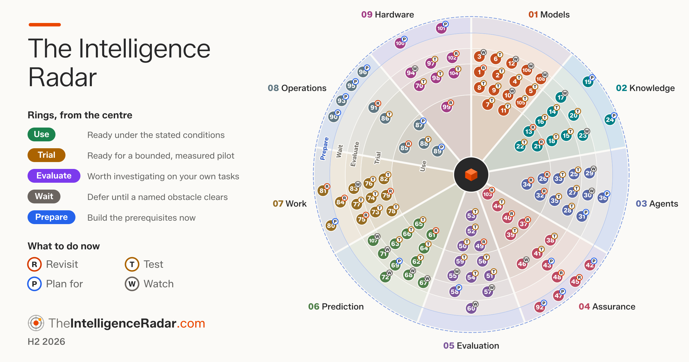
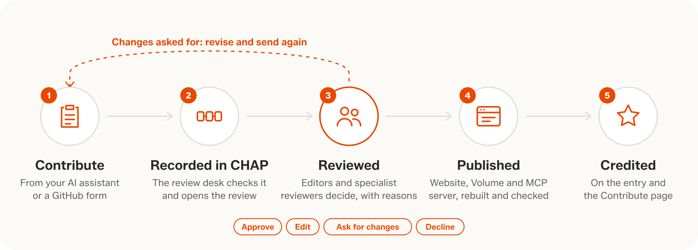

# Contribute to The Intelligence Radar

<picture>
  <source media="(prefers-color-scheme: dark)" srcset="assets/radar-wide-dark.png">
  
</picture>

[TheIntelligenceRadar.com](https://theintelligenceradar.com/) is a community-driven radar for technical leaders, managed by Brightbeam. Anyone can contribute to it here, and its editors and specialist reviewers review every contribution.

## How it works

<picture>
  <source media="(prefers-color-scheme: dark)" srcset="assets/workflow-dark.png">
  
</picture>

Every complete contribution goes to review at once, whoever sends it. Reviews, corrections and evidence need one approval from an editor or a specialist reviewer; label changes and new entries need an editor's. Every decision is posted on the issue with its reason and kept in a private [CHAP](https://github.com/BrightbeamAI/chap) record. Once a contribution of yours is approved, you join the [list of people](PEOPLE.md) as a contributor, unless you chose not to be credited.

## Contribute

| | Contribution | What it is for |
|:-:|---|---|
|  | **[Review an entry](https://www.github.com/BrightbeamAI/Intelligence-Radar-Contributions/issues/new?template=review.yml)** | Does it make sense, read well and carry the right labels? |
|  | **[Correct an entry](https://www.github.com/BrightbeamAI/Intelligence-Radar-Contributions/issues/new?template=correction.yml)** | A fact, figure, date or wording |
|  | **[Add evidence](https://www.github.com/BrightbeamAI/Intelligence-Radar-Contributions/issues/new?template=evidence.yml)** | A source that supports, challenges or qualifies a judgement |
|  | **[Propose a label change](https://www.github.com/BrightbeamAI/Intelligence-Radar-Contributions/issues/new?template=label-change.yml)** | A different label, with its conditions and evidence |
|  | **[Propose a new entry](https://www.github.com/BrightbeamAI/Intelligence-Radar-Contributions/issues/new?template=new-entry.yml)** | A capability or practice not yet judged |
|  | **[From your AI assistant](https://github.com/BrightbeamAI/intelligence-radar-mcp#install)** | The MCP server prepares, checks and sends any of the above |
|  | **[Apply to be a specialist reviewer](https://www.github.com/BrightbeamAI/Intelligence-Radar-Contributions/issues/new?template=apply.yml)** | Decide on contributions alongside the editors: practitioners, researchers and independent experts are welcome |

<!-- The form links go through www.github.com on purpose: a link inside GitHub to issues/new?template=… opens a blank issue, while a full page load opens the form. -->

Each entry's page on the website links to these forms with the entry filled in.

## Where your issue stands

`in-review` → `approved` → `published` (closed). Also `changes-requested` (edit the issue to revise it), `needs-info` (fix the form) and `declined` (with the reason). Editors and specialist reviewers decide with commands in comments, listed in the [guide](CONTRIBUTING.md#for-editors-and-specialist-reviewers).

An editor marks a contribution `published` once it is live on TheIntelligenceRadar.com. Editors normally mark a whole release published at once, with the "Mark release published" workflow in Brightbeam's private site repository: it posts `/published <release> for @editor` on each issue through The Intelligence Radar's publisher app. `/published <release>` on one issue still works.

## Follow contributions

GitHub notifies contributors of every message on their issues. The review desk's messages to contributors carry the TheIntelligenceRadar.com header. Each link below opens a GitHub search:

- [Your contributions](https://github.com/BrightbeamAI/Intelligence-Radar-Contributions/issues?q=is%3Aissue%20author%3A%40me): everything you have sent, open or closed.
- [In review](https://github.com/BrightbeamAI/Intelligence-Radar-Contributions/issues?q=is%3Aissue%20is%3Aopen%20label%3Ain-review): contributions waiting for a decision from the editors and specialist reviewers.
- [Changes requested](https://github.com/BrightbeamAI/Intelligence-Radar-Contributions/issues?q=is%3Aissue%20is%3Aopen%20label%3Achanges-requested): contributions waiting for their contributor to revise them.
- [Approved, waiting for the next release](https://github.com/BrightbeamAI/Intelligence-Radar-Contributions/issues?q=is%3Aissue%20is%3Aopen%20label%3Aapproved): approved contributions that the next release will publish.
- [Published](https://github.com/BrightbeamAI/Intelligence-Radar-Contributions/issues?q=is%3Aissue%20label%3Apublished): contributions that are now part of The Intelligence Radar.

For specialist reviewers and editors:

- [Asked to review](https://github.com/BrightbeamAI/Intelligence-Radar-Contributions/issues?q=is%3Aissue%20is%3Aopen%20label%3Ain-review%20mentions%3A%40me): contributions in review that @mention you, as the review desk does when it asks you to decide.

---

Published under [CC BY 4.0](https://creativecommons.org/licenses/by/4.0/), with credit as you choose. Please read the [guide](CONTRIBUTING.md) and the [code of conduct](CODE_OF_CONDUCT.md).
